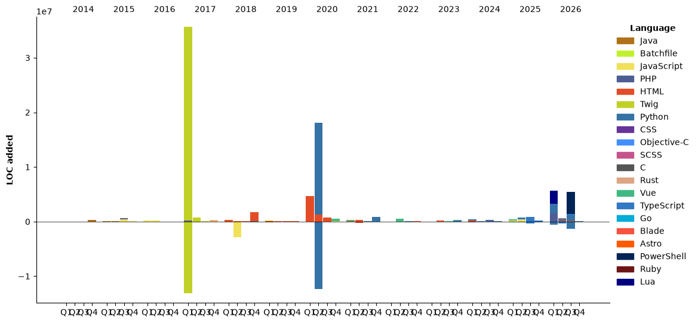

### Hola 👋

<!--START_SECTION:waka-->


**🐱 My GitHub Data** 

> 📦 4.6 MB Used in GitHub's Storage 
 > 
> 🏆 3,327 Contributions in the Year 2026
 > 
> 💼 Opted to Hire
 > 
> 📜 249 Public Repositories 
 > 
> 🔑 87 Private Repositories 
 > 
**I'm an Early 🐤** 

```text
🌞 Morning                12170 commits       ████░░░░░░░░░░░░░░░░░░░░░   16.35 % 
🌆 Daytime                25975 commits       █████████░░░░░░░░░░░░░░░░   34.90 % 
🌃 Evening                26300 commits       █████████░░░░░░░░░░░░░░░░   35.34 % 
🌙 Night                  9976 commits        ███░░░░░░░░░░░░░░░░░░░░░░   13.40 % 
```
📅 **I'm Most Productive on Tuesday** 

```text
Monday                   11937 commits       ████░░░░░░░░░░░░░░░░░░░░░   16.04 % 
Tuesday                  12772 commits       ████░░░░░░░░░░░░░░░░░░░░░   17.16 % 
Wednesday                11712 commits       ████░░░░░░░░░░░░░░░░░░░░░   15.74 % 
Thursday                 11692 commits       ████░░░░░░░░░░░░░░░░░░░░░   15.71 % 
Friday                   11915 commits       ████░░░░░░░░░░░░░░░░░░░░░   16.01 % 
Saturday                 8117 commits        ███░░░░░░░░░░░░░░░░░░░░░░   10.91 % 
Sunday                   6276 commits        ██░░░░░░░░░░░░░░░░░░░░░░░   08.43 % 
```


📊 **This Week I Spent My Time On** 

```text
🕑︎ Time Zone: America/Lima

💬 Programming Languages: 
Markdown                 8 hrs 48 mins       █████████████░░░░░░░░░░░░   51.78 % 
Python                   3 hrs 33 mins       █████░░░░░░░░░░░░░░░░░░░░   20.94 % 
Other                    1 hr 7 mins         ██░░░░░░░░░░░░░░░░░░░░░░░   06.62 % 
PHP                      39 mins             █░░░░░░░░░░░░░░░░░░░░░░░░   03.85 % 
HTML                     37 mins             █░░░░░░░░░░░░░░░░░░░░░░░░   03.64 % 

🔥 Editors: 
Codex Vscode             11 hrs 41 mins      █████████████████░░░░░░░░   68.68 % 
VS Code                  5 hrs 19 mins       ████████░░░░░░░░░░░░░░░░░   31.32 % 

🐱‍💻 Projects: 
narrator                 5 hrs 17 mins       ████████░░░░░░░░░░░░░░░░░   31.06 % 
hualgayok                4 hrs 45 mins       ███████░░░░░░░░░░░░░░░░░░   27.96 % 
athelstan                2 hrs 36 mins       ████░░░░░░░░░░░░░░░░░░░░░   15.28 % 
esantur                  1 hr 5 mins         ██░░░░░░░░░░░░░░░░░░░░░░░   06.42 % 
maytok.com               48 mins             █░░░░░░░░░░░░░░░░░░░░░░░░   04.78 % 

💻 Operating System: 
Windows                  17 hrs 1 min        █████████████████████████   100.00 % 
```

🤖 **AI Coding This Week** 

```text
⏱ AI Coding Time: 13 hrs 49 mins (81.22%)

✍️ 9,720 lines written by AI, 72 lines written by hand (99.26% AI-written)

🔤 6,354,823 Input Tokens, 952,406 Output Tokens

💵 $59.49 Estimated AI Cost This Week

🧠 25 AI Sessions, 147 AI Prompts

GPT                      9,933 lines         █████████████████████████   100.00 % 
Particle                 0 lines             ░░░░░░░░░░░░░░░░░░░░░░░░░   00.00 % 

🔎 AI Coding Insights:
🤖 AI-Driven — 99.26% of written lines came from AI
📄 Detailed Prompter — average 948 characters per prompt
🔁 Iterative Prompter — average 6 prompts per session
🚀 High AI Trust — 1.2% of changed lines were hand-edited
```

**I Mostly Code in Python** 

```text
Python                   40 repos            █████░░░░░░░░░░░░░░░░░░░░   19.61 % 
TypeScript               31 repos            ████░░░░░░░░░░░░░░░░░░░░░   15.20 % 
Vue                      13 repos            ██░░░░░░░░░░░░░░░░░░░░░░░   06.37 % 
Go                       3 repos             ░░░░░░░░░░░░░░░░░░░░░░░░░   01.47 % 
AMPL                     2 repos             ░░░░░░░░░░░░░░░░░░░░░░░░░   00.98 % 
```


**Timeline**




 Last Updated on 01/11/2026 10:32:00 UTC
<!--END_SECTION:waka-->
